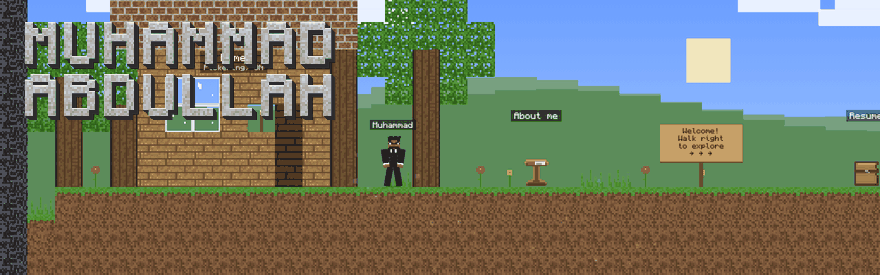
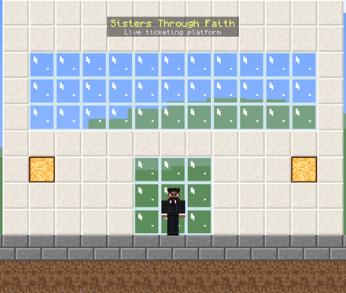
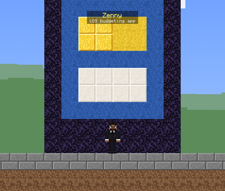
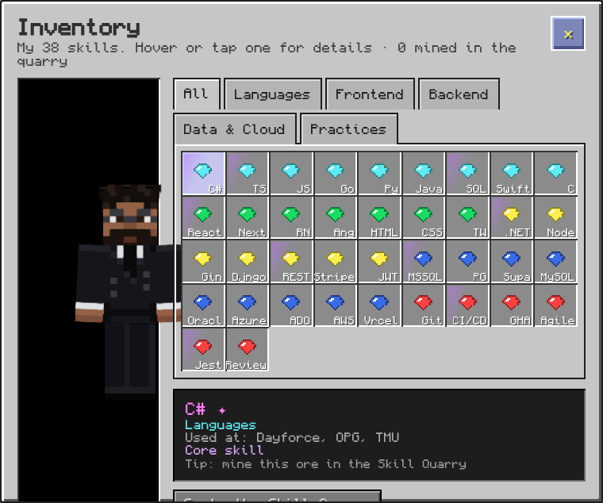

  

  <b>Full-stack software developer at <a href="https://www.dayforce.com">Dayforce</a></b>, building features for an enterprise scheduling platform used by 6.8M+ employees. Toronto, ON 🇨🇦

  
  &nbsp;
  

  
  
  
  

## About

- 💼 Software Developer Associate at **Dayforce**, working across React, .NET, and SQL Server
- ⚡ Focused on API design, query and concurrency optimization, automated testing, and CI/CD
- 🎓 BSc (Honours) Computer Science, **Toronto Metropolitan University** (2026), With Distinction
- 🧱 My portfolio is a block world I built from scratch: walk through my career, mine my skills, and open my projects at **[mabdullah.ca](https://mabdullah.ca)**
- 🔭 Currently building **NearMoi**, a cross-platform event discovery app

## Featured builds

<table>
  <tr>
    <td width="33%" valign="top">
      
      <h3><a href="https://sistersthroughfaith.ca">🎟️ Sisters Through Faith</a></h3>
      
Live event ticketing platform handling hundreds of purchases. Prevents overselling under concurrent demand with atomic PostgreSQL reservations and row-level locking, auto-released via Stripe webhooks.

      <code>Next.js</code> <code>TypeScript</code> <code>PostgreSQL</code> <code>Stripe</code>
    </td>
    <td width="33%" valign="top">
      
      <h3><a href="https://nearmoi.ca">📍 NearMoi</a></h3>
      
Location-ranked event feed served by a Go REST API, with one iOS/Android/web client. A daily GitHub Actions pipeline ingests, geocodes and deduplicates listings from 18 municipal calendars.

      <code>Go</code> <code>Gin</code> <code>PostgreSQL</code> <code>React Native</code>
    </td>
    <td width="33%" valign="top">
      
      <h3><a href="https://zennyapp.netlify.app/">💰 Zenny</a></h3>
      
iOS budgeting app with voice-driven transaction entry and an on-device TF-IDF / k-NN classifier that learns each user's spending categories. Face ID lock and home-screen widgets.

      <code>Swift</code> <code>SwiftUI</code> <code>NaturalLanguage</code>
    </td>
  </tr>
</table>

## Inventory

  
<b>Full tech stack</b>

   

**Languages**

**Frontend**

**Backend & Data**

**Cloud & DevOps**

## Contributions

<picture>
  <source media="(prefers-color-scheme: dark)" srcset="https://raw.githubusercontent.com/muhammadabdullahh/muhammadabdullahh/output/snake-dark.svg">
  
</picture>

Art on this page comes from my portfolio, a Minecraft-inspired world drawn entirely in code. Not an official Minecraft product. Not approved by or associated with Mojang or Microsoft.
